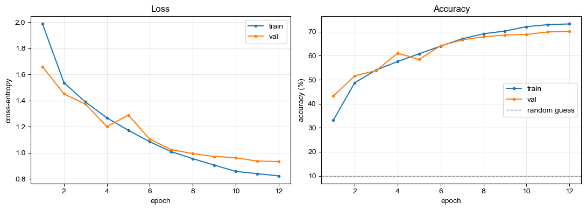
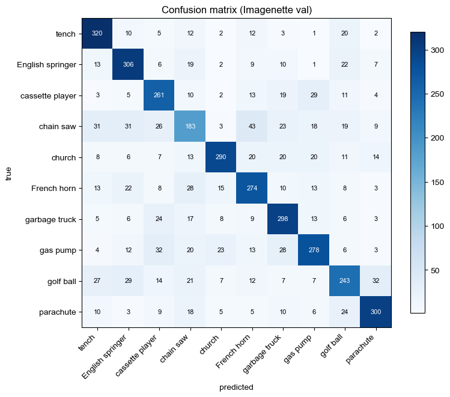
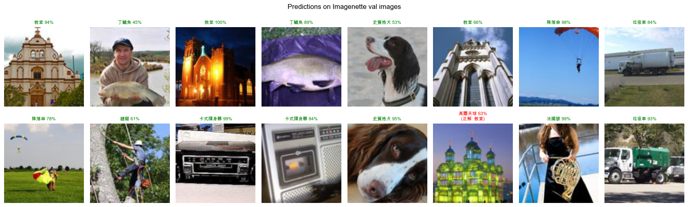
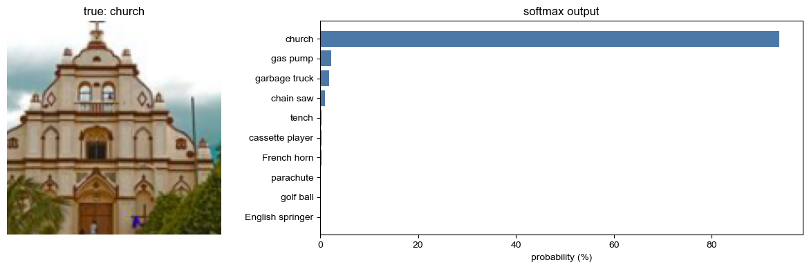
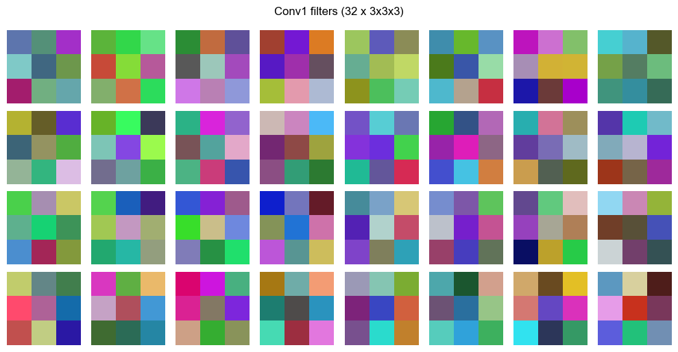
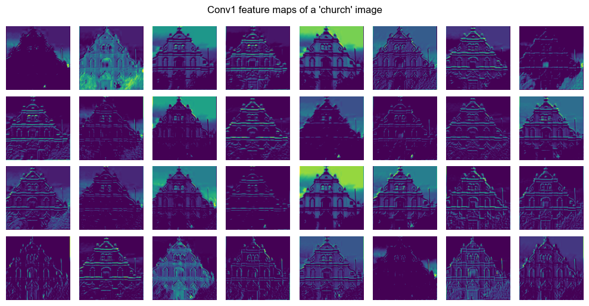
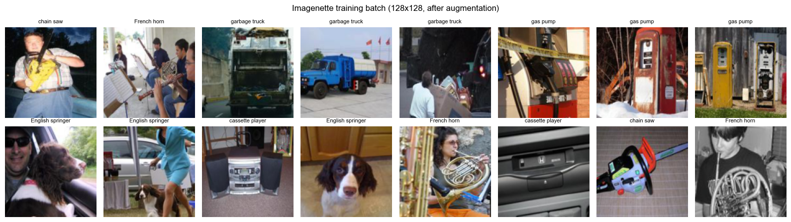

# ML-CNN-Imagenette-Classifier

把 `Conv → ReLU → Pool → Conv → ReLU → Pool → Flatten → Linear → ReLU → Linear`
這條最基本的 CNN → MLP 流程用 PyTorch 完整實作，並且**真的拿真實照片訓練到會辨識**。

資料集是 **Imagenette**（ImageNet 挑出來的 10 類真實照片，9,469 張訓練 / 3,925 張驗證）。
在 Apple Silicon（MPS）上 12 epochs 約 12 分鐘，驗證準確率 **70.14%**（隨機猜 = 10%）。

> 這個專案的重點不是衝高準確率，而是把「兩層卷積的參數幾乎都壓在 Flatten 後的第一層 Linear」
> 這件事用數字與圖攤開來看，並記錄從這裡要往上推該改哪裡。

---

## 結果一覽

| 項目 | 數值 |
|---|---|
| 驗證準確率（best = final，epoch 12） | **70.14%** |
| 訓練準確率（epoch 12） | 73.20% |
| 總參數量（128×128 輸入） | 16,799,434 |
| 其中 `Linear(65536 → 256)` | 16,777,472（**99.87%**） |
| 訓練時間 | 12 epochs / 約 12 分鐘（M 系列 MPS） |
| 裝置 | torch 2.10.0 + torchvision 0.25.0，device = `mps` |

---

## 架構

```
輸入 (N, 3, 128, 128)
  Conv2d(3 → 32, k=3, p=1)   → (N, 32, 128, 128)        896 params
  ReLU
  MaxPool2d(2)               → (N, 32,  64,  64)
  Conv2d(32 → 64, k=3, p=1)  → (N, 64,  64,  64)     18,496 params
  ReLU
  MaxPool2d(2)               → (N, 64,  32,  32)
  Flatten                    → (N, 65536)
  Linear(65536 → 256)        → (N, 256)           16,777,472 params
  ReLU
  Linear(256 → 10)           → (N, 10)                 2,570 params   ← logits
```

卷積輸出尺寸：$O = \lfloor (I + 2P - K)/S \rfloor + 1$，`padding=1, k=3, s=1` 讓長寬不變，
長寬只由兩次 `MaxPool2d(2)` 各砍一半。

**為什麼輸入是 128 不是 224**：同一個架構吃 224×224 時，Flatten 後是 `64×56×56 = 200,704` 維，
第一層 Linear 就要 **51,380,480** 個參數（佔全模型 **99.96%**），在 MPS/CPU 上訓練不現實。
架構一行都沒改，只把輸入換成 128×128，Flatten 變成 `64×32×32 = 65,536` 維。
Notebook 第 1 部分用 `(4, 3, 224, 224)` 假輸入把 224 的版本逐層跑過一遍對照架構表。

| 層 | 224 版參數 | 佔比 |
|---|---:|---:|
| Conv1 | 896 | 0.00% |
| Conv2 | 18,496 | 0.04% |
| Linear1 | 51,380,480 | **99.96%** |
| Linear2 | 2,570 | 0.00% |
| TOTAL | 51,402,442 | |

---

## 訓練設定

- loss：`CrossEntropyLoss`（內含 log-softmax，所以 `forward` 回傳 logits，不要自己先 softmax）
- optimizer：Adam，`lr=1e-3`、`weight_decay=1e-4`
- scheduler：`CosineAnnealingLR(T_max=12)`
- augmentation：train 用 `RandomResizedCrop(128, scale=(0.5,1.0))` + `RandomHorizontalFlip`；
  val 只做 `Resize(146)` + `CenterCrop(128)`；兩者都用 ImageNet 的 mean / std 做 Normalize
- batch size：train 64 / val 128

### 訓練曲線



```
epoch  1/12  train loss 1.9866 acc 33.10%  |  val loss 1.6589 acc 43.18%  (184.1s, lr=9.83e-04)  <- best
epoch  2/12  train loss 1.5364 acc 48.75%  |  val loss 1.4513 acc 51.64%  ( 81.6s, lr=9.33e-04)  <- best
epoch  3/12  train loss 1.3890 acc 54.05%  |  val loss 1.3725 acc 53.78%  ( 48.7s, lr=8.54e-04)  <- best
epoch  4/12  train loss 1.2677 acc 57.56%  |  val loss 1.2010 acc 61.07%  ( 47.3s, lr=7.50e-04)  <- best
epoch  5/12  train loss 1.1721 acc 60.80%  |  val loss 1.2888 acc 58.42%  ( 46.5s, lr=6.29e-04)
epoch  6/12  train loss 1.0842 acc 63.98%  |  val loss 1.1039 acc 64.10%  ( 46.3s, lr=5.00e-04)  <- best
epoch  7/12  train loss 1.0087 acc 67.00%  |  val loss 1.0249 acc 66.55%  ( 43.6s, lr=3.71e-04)  <- best
epoch  8/12  train loss 0.9549 acc 69.10%  |  val loss 0.9932 acc 67.85%  ( 43.0s, lr=2.50e-04)  <- best
epoch  9/12  train loss 0.9058 acc 70.24%  |  val loss 0.9721 acc 68.59%  ( 41.5s, lr=1.46e-04)  <- best
epoch 10/12  train loss 0.8577 acc 72.05%  |  val loss 0.9625 acc 68.82%  ( 45.6s, lr=6.70e-05)  <- best
epoch 11/12  train loss 0.8403 acc 72.90%  |  val loss 0.9364 acc 69.86%  ( 46.1s, lr=1.70e-05)  <- best
epoch 12/12  train loss 0.8233 acc 73.20%  |  val loss 0.9330 acc 70.14%  ( 44.9s, lr=0.00e+00)  <- best
```

12 個 epoch 全程 val 都還在往上，cosine 把 lr 壓到 0 才停，沒有出現 val loss 翻上去的典型過擬合轉折，
但 train acc（73.20%）已經穩定高於 val acc（70.14%）約 3 個百分點 —— 這個差距的來源就是那層 1,677 萬參數的 Linear。

---

## 評估

### 每類準確率

| class | 中文 | accuracy | support |
|---|---|---:|---:|
| tench | 丁鱥魚 | 82.69% | 387 |
| English springer | 史賓格犬 | 77.47% | 395 |
| parachute | 降落傘 | 76.92% | 390 |
| garbage truck | 垃圾車 | 76.61% | 389 |
| cassette player | 卡式隨身聽 | 73.11% | 357 |
| church | 教堂 | 70.90% | 409 |
| French horn | 法國號 | 69.54% | 394 |
| gas pump | 加油槍 | 66.35% | 419 |
| golf ball | 高爾夫球 | 60.90% | 399 |
| **chain saw** | 鏈鋸 | **47.41%** | 386 |

### Confusion matrix



最常混淆的五組：

```
         chain saw 被判成 French horn       43 次
         golf ball 被判成 parachute         32 次
          gas pump 被判成 cassette player   32 次
         chain saw 被判成 tench             31 次
         chain saw 被判成 English springer  31 次
```

鏈鋸（47.41%）明顯拖累整體，而且錯得很分散 —— 被判成法國號、丁鱥魚、史賓格犬都有。
這類照片通常是「人手持握著某個細長金屬物件、背景雜亂的戶外」，兩層卷積抽到的
只有邊緣與色塊層級的特徵，分不出細長物件的種類，只能靠背景猜。
高爾夫球被判成降落傘（白色圓形 vs 白色傘面）同樣是純低階特徵造成的誤判。

### 實際推論



隨機抽 16 張驗證集影像，對 15 張（綠色標題為判對、紅色為判錯，括號內是正解）。

單張影像的完整 softmax 分佈：



```
top-3:
  church            教堂           93.84%
  gas pump          加油槍           2.30%
  garbage truck     垃圾車           1.85%
```

---

## 卷積學到什麼

左：第一層 32 個 `3×3×3` filter 的權重直接當 RGB 小圖畫出來。
右：同一張教堂照片經過 `Conv1 + ReLU` 之後的 32 張 feature map。

| Conv1 filters | Conv1 feature maps |
|---|---|
|  |  |

只有兩層，學到的就是邊緣、色彩對比、明暗區塊這種低階特徵 —— 這也解釋了為什麼
「細長金屬物件」這種需要語意層級的類別會輸得這麼難看。

訓練資料經過 augmentation 後長這樣：



---

## 怎麼跑

```bash
git clone https://github.com/lukerspace/ML-CNN-Imagenette-Classifier.git
cd ML-CNN-Imagenette-Classifier
pip install -r requirements.txt
jupyter lab cnn_pytorch.ipynb
```

資料集**不在 repo 裡**（129MB）。Notebook 的 `Imagenette(..., download=True)` 第一次執行會自己
下載解壓到 `./data/`，之後直接讀本機，不會重抓。

### 用訓練好的權重直接推論

權重檔各 67MB，放在 [Releases](https://github.com/lukerspace/ML-CNN-Imagenette-Classifier/releases) 而不是 repo 裡：

| 檔案 | 說明 |
|---|---|
| `cnn_imagenette.pt` | 最終權重，附 `classes` / `img_size` / `mean` / `std` / `val_acc` 等 metadata |
| `cnn_imagenette_best.pt` | 訓練過程中 val acc 最佳的 checkpoint（本次 = 最後一個 epoch，兩者等價） |

```bash
mkdir -p checkpoints
gh release download v1.0 -R lukerspace/ML-CNN-Imagenette-Classifier -D checkpoints
```

```python
import torch, torch.nn as nn

class CNN_MLP(nn.Module):                      # 與 notebook 2.2 節同一份
    def __init__(self, in_channels=3, img_size=128, num_classes=10):
        super().__init__()
        self.features = nn.Sequential(
            nn.Conv2d(in_channels, 32, 3, padding=1), nn.ReLU(), nn.MaxPool2d(2),
            nn.Conv2d(32, 64, 3, padding=1),          nn.ReLU(), nn.MaxPool2d(2),
        )
        self.flatten = nn.Flatten()
        side = img_size // 4
        self.flat_dim = 64 * side * side
        self.classifier = nn.Sequential(
            nn.Linear(self.flat_dim, 256), nn.ReLU(), nn.Linear(256, num_classes),
        )

    def forward(self, x):
        return self.classifier(self.flatten(self.features(x)))


ckpt  = torch.load("checkpoints/cnn_imagenette.pt", map_location="cpu", weights_only=False)
model = CNN_MLP(img_size=ckpt["img_size"], num_classes=len(ckpt["classes"]))
model.load_state_dict(ckpt["state_dict"])
model.eval()
```

Notebook 2.7 節的 `predict_image(path)` 可以直接吃任何一張本機 jpg/png，回傳 top-3 類別與機率
（只有這 10 類，丟別的東西進去它一定會硬猜一個）。

---

## 專案結構

```
ML-CNN-Imagenette-Classifier/
├── cnn_pytorch.ipynb        # 主要內容：形狀驗證 → 訓練 → 評估 → 視覺化 → 存檔推論
├── assets/                  # README 用的圖，全部從 notebook 輸出抽出來
├── requirements.txt
├── data/                    # 自動下載，.gitignore（129MB）
└── checkpoints/             # 從 Releases 下載，.gitignore（各 67MB）
```

Notebook 分兩部分：

| 部分 | 內容 |
|---|---|
| 第 1 部分 | 用 `(4, 3, 224, 224)` 假輸入逐層驗證輸出形狀與參數量，對照架構表 |
| 第 2 部分 | 同一個架構接 Imagenette：資料 → 模型 → 訓練 → 評估 → 推論 → 存檔 / 載回 |

---

## 這個架構的瓶頸，與往上推的做法

1. **瓶頸在 Flatten，不在卷積。** 224 版 99.96%、128 版 99.87% 的參數都在 Flatten 後的
   第一層 Linear。兩層卷積加起來只有 19,392 個參數，佔 0.1% 都不到。
2. **過擬合的來源也是它。** train acc 高於 val acc，壓它最有效的不是加更多正則化，
   而是先把這層的參數量砍掉。

往上推的標準做法，照效益排序：

1. 用 `AdaptiveAvgPool2d(1)` 取代巨大的 Flatten → 參數少一到兩個數量級、過擬合大幅下降
2. 每個 Conv 後加 `BatchNorm2d` → 收斂更快更穩
3. 堆到 3~4 段卷積，通道 32 → 64 → 128 → 256 → 才抽得到語意層級特徵（鏈鋸那類才有救）
4. 加 `Dropout`、換 SGD + momentum 搭配更長的 cosine schedule
5. 真的要高準確率就 `torchvision.models.resnet18(weights=...)` 做 transfer learning

---

## 授權

MIT
